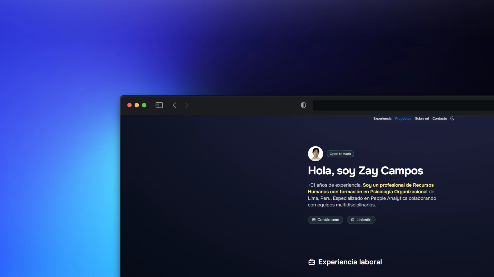

# Zay Campos · People Analytics & Data

**Analista de People Analytics y Data** en Corporación Overall · Lima, Perú 
Bachiller en Psicología Organizacional · Especialización en People Analytics · Maestría en Data Science (UNI, en curso)

[🌐 Portfolio](https://iridescent-bavarois-0f8a8f.netlify.app/) · [💼 LinkedIn](https://www.linkedin.com/in/zay-campos-rosas-5376a2256/) · [📄 CV](https://iridescent-bavarois-0f8a8f.netlify.app/CV_ZAY_CAMPOS_ROSAS.pdf) · [✉️ zcamposrosas@gmail.com](mailto:zcamposrosas@gmail.com)

---

## 👋 Sobre mí

Uno la psicología organizacional con los datos para responder preguntas de negocio sobre las personas: por qué rotan, qué impulsa el desempeño y cómo mejorar la productividad de los equipos.

Tengo **2 años de experiencia** en Gestión del Talento, construyendo indicadores y proyectos de analítica de punta a punta: desde el gobierno y la recolección de los datos hasta los dashboards en Power BI y los informes ejecutivos que usan los líderes para decidir.

---

## 📊 Qué aporto

- **Analítica de talento orientada al negocio:** convierto indicadores de rotación, desempeño, clima y atracción en insights y recomendaciones accionables.
- **Reportería en Power BI de punta a punta:** diseño, construcción y mantenimiento de dashboards para áreas internas.
- **Gobierno de datos:** diseño de data marts y modelos de datos que ordenan la información de Gestión de Desarrollo Humano y facilitan su análisis.
- **Comunicación de resultados:** informes ejecutivos y presentaciones que traducen los datos en una historia clara para clientes internos.
- **Base en comportamiento humano:** psicometría, entrevistas por competencias y Assessment Centers, que me ayudan a interpretar los datos con contexto.

---

## 💼 Experiencia

**Analista de People Analytics y Data** · Corporación Overall · *Nov 2026 – actualidad*
- Lidero la analítica de personas de Talento y Cultura y consolido el modelo de Gobierno de Datos.
- Mantengo dashboards en Power BI de clima laboral, desempeño y rotación para la toma de decisiones de los líderes.

**Asistente de Talento y Cultura** · Corporación Overall · *Nov 2025 – Nov 2026*
- Lideré un plan de Gobierno de Datos con data marts para las subáreas de Gestión de Desarrollo Humano.
- Gestioné la reportería integral de clima, desempeño y rotación: de las encuestas a Power BI y a los informes ejecutivos.

**Practicante de HR Analytics** · Grupo Lucky · *Ago 2025 – Nov 2025*
- Construí en Power BI el funnel de conversión del programa de referidos (candidatos → contratados).
- Hice seguimiento mensual de KPIs de atracción: tiempo de cobertura, productividad por reclutador y tasa de contratación.

**Practicante de Recursos Humanos** · Grupo Trianon · *Set 2024 – Ago 2025*
- Establecí un modelo de gobierno de datos en adquisición de talento que permitió el análisis de KPIs.
- Gestioné reclutamiento y selección para posiciones operativas, mandos medios y jefaturas.

---

## 🛠 Herramientas

**Datos y visualización:** SQL · Python · Power BI · Excel 
**Métodos:** Estadística · A/B testing y pilotos 
**Organización:** Notion · Trello

---

## 🚀 Proyectos

- **[Dashboard de ventas en Power BI](https://iridescent-bavarois-0f8a8f.netlify.app/#proyectos):** proceso ETL (Extract, Transform, Load) para la limpieza de datos y visualización dinámica de indicadores.

Más proyectos de People Analytics en camino. Puedes verlos en mi [portfolio](https://iridescent-bavarois-0f8a8f.netlify.app/).
